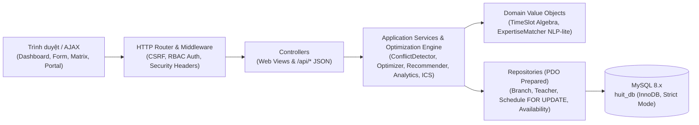
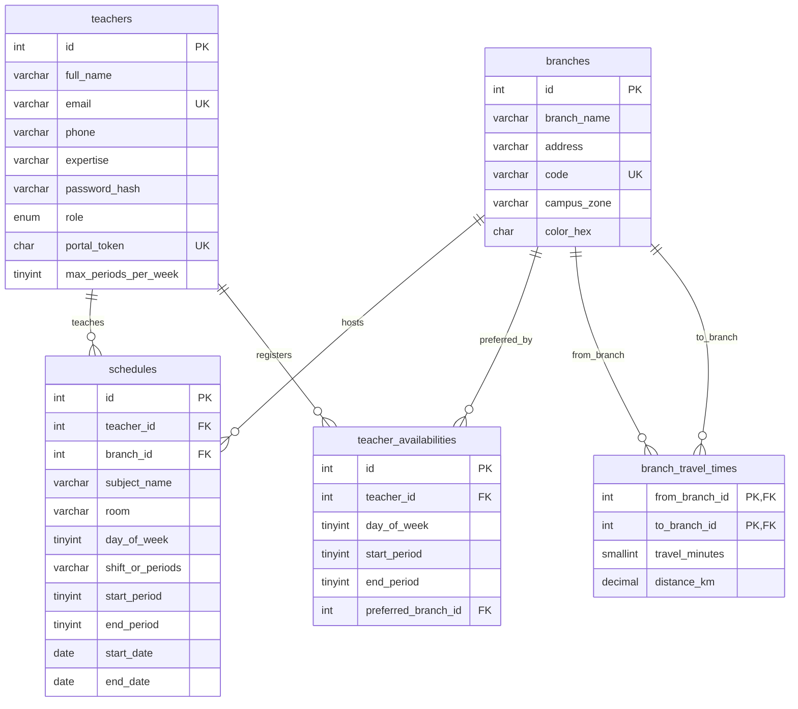

# HUIT Schedule Hub — Hệ thống Quản lý & Phân lịch Giảng dạy Đa Cơ sở Thông minh

[](https://www.php.net/)
[](https://www.mysql.com/)
[](LICENSE)
[](.github/workflows/php-lint.yml)

**HUIT Schedule Hub** là ứng dụng web mã nguồn mở hỗ trợ Phòng Đào tạo Trường Đại học Công Thương TP.HCM (HUIT) quản lý, tối ưu hóa và tự động hóa quy trình phân công giảng dạy trên nhiều cơ sở (Tân Phú & Quận 12). Hệ thống loại bỏ triệt để xung đột giảng viên/phòng học bằng khóa giao dịch MySQL, phát hiện di chuyển bất khả thi giữa các cơ sở, định lượng khoảng trống chết (*Dead Gap*) và gợi ý giảng viên tối ưu theo thang điểm minh bạch 0–100.

---

## 1. Kiến trúc Hệ thống (Clean 5-Layer Architecture)



### Bảo mật & Toàn vẹn dữ liệu (Defense-in-Depth)
- **Concurrency Safety:** Mọi thao tác tạo/cập nhật lịch dạy đều bọc trong **MySQL Transaction** (`BEGIN` → `SELECT ... FOR UPDATE` → kiểm tra xung đột cứng → `INSERT/UPDATE` → `COMMIT`).
- **SQL Injection Prevention:** 100% PDO Prepared Statements (`ATTR_EMULATE_PREPARES => false`, MySQL `STRICT_TRANS_TABLES`).
- **Web Security:** Helper `e()` chống XSS, CSRF token (`random_bytes(32)` + `hash_equals()`, HTTP `403` khi sai), mật khẩu `PASSWORD_BCRYPT`, `session_regenerate_id(true)`, cookie `HttpOnly + SameSite=Lax`, Security Headers và `.htaccess` chặn truy cập trực tiếp `.env`, `src/`, `config/`, `database/`, `tests/`, `vendor/`.

---

## 2. Thiết kế Cơ sở dữ liệu (ERD — 3NF)



---

## 3. Động cơ Thuật toán Thông minh

### 3.1. Ma trận Thời gian Di chuyển thực tế (Travel-Time Matrix)
| Tuyến cơ sở HUIT | Thời gian | Khoảng cách |
| :--- | :---: | :---: |
| **CS1** (140 Lê Trọng Tấn, Tân Phú) $\leftrightarrow$ **CS3** (31 Chế Lan Viên, Tân Phú) | **6 phút** | 0.8 km |
| **CS1** (Lê Trọng Tấn) $\leftrightarrow$ **CS2** (93 Tân Kỳ Tân Quý, Tân Phú) | **15 phút** | 2.6 km |
| **CS2** (Tân Kỳ Tân Quý) $\leftrightarrow$ **CS3** (Chế Lan Viên) | **14 phút** | 2.3 km |
| **CS1 / CS2 / CS3** (Tân Phú) $\leftrightarrow$ **CS4** (Trung tâm Liên kết Q.12) | **35–40 phút** | 9.5–11.0 km |

Với mỗi cặp ca kế tiếp $(X, Y)$ cùng ngày tại 2 cơ sở khác nhau:
- `travel > break` $\Rightarrow$ **`IMPOSSIBLE_TRAVEL`** (Đỏ — *Không kịp di chuyển*).
- `break - travel < 15` $\Rightarrow$ **`TIGHT_TRAVEL`** (Vàng — *Di chuyển sát giờ, rủi ro kẹt xe*).
- Chuyển cơ sở $> 2$ lần/ngày $\Rightarrow$ **`EXCESSIVE_COMMUTE`**.

### 3.2. Định lượng Khoảng trống chết (`Dead Gap`) & Chỉ số Sức khỏe Tối ưu
- Giữa 2 ca liên tiếp $(X, Y)$, nếu $\text{gapPeriods} = Y.s - X.e - 1 \ge 3$ $\Rightarrow$ cảnh báo **`DEAD_GAP`**.
- Tổng khoảng trống chết trong ngày: $\text{DeadGapDay} = (\max e_i - \min s_i + 1) - \sum_i (e_i - s_i + 1)$.
- Chỉ số Sức khỏe Tối ưu Toàn trường (`0–100%`):
  $$\text{HealthScore} = \text{clamp}\left(100 - 15 \cdot N_{\text{impossible}} - 5 \cdot N_{\text{tight}} - 3 \cdot N_{\text{dead\_gap}} - 2 \cdot \sigma_{\text{load}},\; 0,\; 100\right)$$

### 3.3. Gợi ý Giảng viên Đa mục tiêu Minh bạch (`0–100 điểm`)
Giảng viên trùng lịch bị loại cứng sang danh sách `unavailable` kèm lý do rõ ràng. Giảng viên khả dụng được chấm điểm công khai:
1. **Chuyên môn phù hợp (`0–40đ`):** NLP-lite bỏ dấu tiếng Việt + loại bỏ stop-words học thuật + từ điển 7 cụm CNTT + độ tương đồng Jaccard (`+40` trực tiếp, `+25` cùng cụm, `+12` một phần).
2. **Khớp tiết trống đăng ký (`0–25đ`):** `+20đ` nếu khớp `teacher_availabilities`, `+5đ` nếu đúng `preferred_branch_id`.
3. **Tối ưu di chuyển & khoảng trống (`-25` đến `+20đ`):** Liền ca cùng cơ sở `+20đ`, ngày sạch `+12đ`, tạo `DEAD_GAP` `0đ`, khác cơ sở thoải mái `-5đ`, `TIGHT_TRAVEL` `-12đ`, `IMPOSSIBLE_TRAVEL` `-25đ`.
4. **Cân bằng tải tuần (`0–15đ`):** $\text{round}\left(15 \times \max\left(0, 1 - \frac{\text{assigned}}{\text{max}}\right)\right)$.

---

## 4. Hướng dẫn Cài đặt chi tiết trên Laragon (Windows)

### Bước 1: Clone mã nguồn vào thư mục Laragon
```bash
cd C:\laragon\www
git clone https://github.com/<your-username>/huit-schedule.git huit-schedule
cd huit-schedule
```

### Bước 2: Cài đặt thư viện Composer (`vlucas/phpdotenv`, `fakerphp/faker`)
```bash
composer install
```

### Bước 3: Cấu hình biến môi trường (`.env`)
Sao chép `.env.example` thành `.env`:
```powershell
Copy-Item .env.example .env
```

| Biến môi trường | Giá trị mặc định (Laragon) | Mô tả |
| :--- | :--- | :--- |
| `APP_NAME` | `"HUIT Schedule Hub"` | Tên hiển thị của hệ thống |
| `APP_URL` | `http://huit-schedule.test` | URL gốc Virtual Host Laragon |
| `APP_ENV` | `local` | Môi trường (`local` hoặc `production` để ẩn debug/stack trace) |
| `APP_TIMEZONE` | `Asia/Ho_Chi_Minh` | Múi giờ chuẩn dùng cho Lịch & xuất `.ics` |
| `DB_HOST` | `localhost` | Máy chủ MySQL (bắt buộc — hỗ trợ `localhost` hoặc `127.0.0.1`) |
| `DB_PORT` | `3306` | Cổng MySQL |
| `DB_NAME` | `huit_db` | Tên cơ sở dữ liệu (bắt buộc) |
| `DB_USER` | `root` | Tài khoản MySQL (bắt buộc) |
| `DB_PASS` | *(trống)* | Mật khẩu MySQL |

### Bước 4: Khởi tạo Cơ sở dữ liệu `huit_db`
Chọn **1 trong 2 cách**:

- **Cách A — Import 1 bước bằng `database/huit_db.sql` (Nhanh nhất):**
  - *HeidiSQL (trên Laragon):* Mở **Database** → `File` → `Load SQL file...` → chọn `database/huit_db.sql` → bấm **Run (F9)**.
  - *MySQL CLI:*
    ```bash
    mysql -u root < database/huit_db.sql
    ```
- **Cách B — Import Schema + Chạy Seeder Faker (`database/seed.php`):**
  ```bash
  mysql -u root < database/schema.sql
  php database/seed.php --fresh
  ```

### Bước 5: Truy cập ứng dụng
Khởi động **Apache & MySQL** trên Laragon (bật *Auto Virtual Hosts*) và mở trình duyệt:
- Virtual Host: `http://huit-schedule.test`
- Hoặc subpath: `http://localhost/huit-schedule`

### Bước 6: Kiểm tra môi trường & Chạy bộ kiểm thử tự động
```bash
# 1. Kiểm tra toàn bộ môi trường, PHP extensions, .env, DB và kiến trúc
composer doctor

# 2. Kiểm thử đơn vị (thuần PHP, không cần DB)
php tests/unit_tests.php

# 3. Kiểm thử tích hợp 10 kịch bản trên MySQL huit_db (tự rollback giữ sạch dữ liệu)
php tests/integration_verify.php
```

---

## 5. Tài khoản Demo & Đường dẫn Portal Cá nhân

| Vai trò | Email | Mật khẩu | Phạm vi truy cập |
| :--- | :--- | :--- | :--- |
| **Cán bộ Đào tạo (Admin)** | `admin@huit.edu.vn` | `Admin@123` | Toàn bộ Dashboard (KPI, Chart.js, Timeline Gantt, Auto-Fix 1-click), Phân lịch thông minh, Ma trận, CRUD Cơ sở & Giảng viên, Xuất CSV, API |
| **Giảng viên (Demo)** | `giangvien@huit.edu.vn` | `Teacher@123` | Cổng Giảng viên (`/portal`), Lịch Tuần/Tháng, Lộ trình di chuyển, Xuất `.ics`, Đăng ký tiết trống |

- **Ví dụ Link Portal cá nhân (read-only không cần đăng nhập):**
  `http://huit-schedule.test/portal?token=fdb414c31ad4ae40955a09077d27e2f6ddfbb28c3194e84df29367ca6dfd4c29` *(xem nút "Sao chép Link" tại trang Quản lý Giảng viên để lấy link chính xác từng giảng viên)*.

---

## 6. Danh sách API & Export Endpoints

| Method | Endpoint | Mô tả |
| :--- | :--- | :--- |
| `GET` | `/api/suggest-teachers` | Xếp hạng giảng viên 0–100đ + danh sách giảng viên đang bận & lý do |
| `GET` | `/api/check-conflict` | Kiểm tra xung đột cứng (GV/Phòng) + cảnh báo di chuyển & khoảng trống chết |
| `GET` | `/api/suggest-slots` | Trả về Top 5 khung tiết trống tối ưu nhất cho `(teacher_id, branch_id, duration)` |
| `GET` | `/api/available-rooms` | Liệt kê phòng học đang trống (Phòng máy / Lý thuyết) và phòng đang bận tại cơ sở theo khung giờ |
| `GET` | `/api/dashboard-stats` | Trả về KPI, Health Score, dữ liệu 3 biểu đồ Chart.js, Timeline Gantt và danh sách cảnh báo |
| `POST` | `/schedules/auto-fix/{id}` | Tự động dời lịch theo gợi ý tối ưu (có CSRF + giao dịch `FOR UPDATE` + tự chọn phòng trống nếu phòng cũ bận) |
| `GET` | `/schedules/export-csv` | Xuất danh sách lịch dạy theo bộ lọc ra tệp CSV chuẩn UTF-8 BOM mở trực tiếp bằng Excel |
| `GET` | `/portal/export-ics` | Tải tệp lịch giảng dạy cá nhân chuẩn **RFC 5545 (`.ics`)** cho Google/Apple/Outlook Calendar |

---

## 7. Giấy phép (License)

Dự án được phát hành theo giấy phép **[MIT License](LICENSE)** — Copyright © 2026 HUIT Schedule Hub Contributors.
